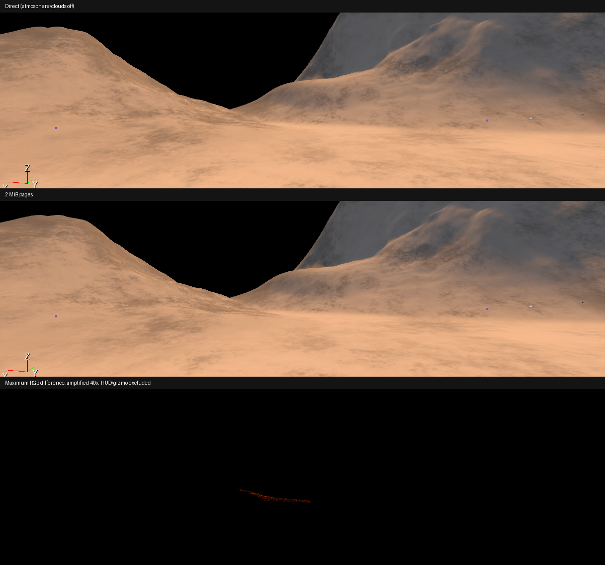

# Bounded overlap-page cache prototype — 2026-10-24

The prototype is **not a speed or memory improvement in the saved Terrain6/7 view**. It remains opt-in and disabled. Original material bindings, terrain visibility, precision, camera, atmosphere/cloud settings and saved level bytes were restored. No changes were pushed or enabled in the saved scene.

## Implementation

`tools/BuildOverlapPages.py` creates a fixed sixteen-slot, world-XY page atlas for the current two-source FP16 overlap publication. Four linear RGBA16F attachments store composed unlit material channels and validity, with one-texel page gutters. Lighting and ground contact remain live. Height queries and materials remain available for fallback. The shader rejects missing textures, out-of-window coordinates, invalid coverage, unsupported precision/features, and filtering footprints above 1.5 cache texels. A shader option defaults the cache off.

This is an **offline CPU-baked, fixed-layout prototype**, not a runtime virtual-texture streamer. It has no eviction, visible-page allocation, GPU update pass or incremental edit scheduler. The baker uses source PNGs rather than the cooked BC textures; numerical/filtering equivalence is not assumed. Source hashes are checked before the profiling harness binds immutable experimental materials. The harness freezes overlap publication while testing and restores the original bindings. Do not leave these experimental child materials bound during live editing; production invalidation is not integrated.

## Matched measurements

DX12 Editor, AMD Radeon(TM) Graphics, 1203 × 656, MSAA 2×, FP16, both retained terrains visible. Position: (1025.0732421875, 488.1408386230469, 43.456932067871094). Rotation: (-13.2926664352417, 4.55283784866333, 161.42835998535156). Terrain geometry/LOD and pacing were retained. Each alternating direct/pages/direct/pages case requests 240 frames. Values below average the two capture medians, not FPS conversions.

| View and cache | Direct GPU ms | Pages GPU ms | Change | Added texture payload |
|---|---:|---:|---:|---:|
| Full scene, 1024 atlas | 48.545 | 50.137 | +1.592 ms (+3.28%) | 32 MiB |
| Atmosphere/clouds off, 1024 atlas | 41.485 | 43.323 | +1.837 ms (+4.43%) | 32 MiB |
| Atmosphere/clouds off, 256 atlas | 41.440 | 43.181 | +1.741 ms (+4.20%) | 2 MiB |

The 1024 atlas accepted no **debug-visible cached pixels** in this view, so those rows characterize lookup/fallback overhead, not the benefit of cached material shading. A temporary color-coded rejection diagnostic showed terrain outside the overlap rectangle, unsupported filtering footprints, and invalid blend coverage. That diagnostic was removed and the measured shader restored byte-for-byte before the 256 comparison.

The 256 atlas produces 855 debug-visible changed pixels (0.122% of the 701,014-pixel comparison region), confirming actual cache use along a short visible seam. This is a screenshot observation, not a hardware fragment hit counter. Reuse is too small to repay the added path's overhead in this view. Register pressure, shader size and lookup work are possible costs; no new counters isolate their respective contribution.

With atmosphere/clouds off, one Sky Atmosphere, one HDRI Sky background, two Finite Cloud Volumes, and one Vue aerial-visibility control were disabled temporarily. No Fog or Volumetric Fog component was present. Sun/IBL lighting remained. Independent delayed enabled-pass pipeline samples reported zero cloud volumes and supported the frame GPU measurements; per-pass stale timestamps were not summed. Engine CPU intervals include render/GPU waits: the 2 MiB direct/pages medians average 42.072/43.876 ms and are not isolated CPU work measurements.

Main Forward and Depth each retain 2,426,734 primitives; Forward retains 994,108 pixel shader invocations. Geometry reduction is not responsible for these results.

## Memory and appearance

The 32 MiB allocation raised DXGI process local-memory usage by 34 MiB on first binding; the 2 MiB allocation raised it by 2 MiB. Allocation retention means later direct cases can retain cache-related memory; these are first-bind deltas, not per-frame allocation rates or total-device VRAM. RHI HUD resident texture changes corroborated the texture payload sizes. Source textures remain resident/available for fallback, so neither prototype reduces total memory.

The 256 atlas's CPU bake took approximately 0.353 seconds, versus 3.658 seconds for the measured 1024 publication. These are offline CPU wall times. Asset processing/upload latency and GPU update milliseconds were not isolated; no runtime update scheduler exists.

With atmosphere/clouds off, 653 of 701,014 tested pixels change between direct and the 2 MiB cache. Maximum channel error is 6/255; 172 pixels differ by more than one channel level. The direct repeat and cached repeat are individually identical. The bound-page-material **fallback-only** control is pixel-identical to direct rendering. The 32 MiB appearance comparison is not a quality validation of cached materials, because its visible path falls back.

## Validation and reproduction

The Editor native build completed, current shader/image/material asset jobs completed, and 21 focused tests passed: four page storage/filtering contracts, thirteen overlap publication tests, and four synchronization tests. Page-border tests exercise 64/128/256-pixel physical page pitches. This is not a full regression-suite pass. A startup RenderPass SRG image-index assertion persisted in baseline and experimental launches before capture; rebuilding did not remove it. No clean-engine certification is claimed.

Use a Python environment with NumPy and Pillow to run `tools/BuildOverlapPages.py --project <TGProject> --size 256`. Then run Editor with `--runpython tools/ProfileOverlapPages.py`, setting `TC_OVERLAP_PAGE_REFERENCE` to an existing results JSON containing the saved camera/viewport, `TC_OVERLAP_PAGE_PUBLICATION` to the generated publication.json, and `TC_OVERLAP_PAGE_OUTPUT` to a new output folder. This portable harness disables atmosphere/clouds and restores them after the comparison. The cache remains disabled in generated materials until an explicit profiling override.

Raw local captures are under `TGProject/user/TerrainSceneProfile/20261024-overlap-pages-prototype-v4`, `20261024-overlap-pages-isolated`, and `20261024-overlap-pages-coarse`. Full timings, memory readings, source hashes, image comparisons and restoration evidence are in the companion JSON. The earlier v3 run and temporary rejection-color captures are excluded from the final performance comparison.

## Decision

Do not promote this cache layout. A subsequent architectural experiment should first classify seam/contributor regions before the expensive overlap query path, or allocate material pages specifically around visible seams with suitable mip/filtering support. The current results justify investigating those alternatives; they do not establish their speedup, nor rule out material caching in other workloads.
